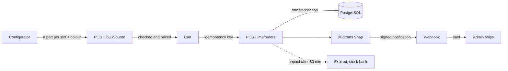

# Rakit

An online store for e-bike parts, built around one bike: the **Rakit E-1**. Visitors build their E-1 part by
part in a 3D configurator, or buy any part on its own. A React storefront, a NestJS API on PostgreSQL,
Midtrans (sandbox) payments and an admin dashboard.

**Live demo:** https://yogi-store.vercel.app — sign in with "Try as shopper" or "Try as admin", no sign-up
needed. A demo store: prices and stock are examples, payments run in Midtrans sandbox and no money moves.

Started as a rebuild of my 2022 bootcamp capstone (MERN), redone with a modern stack and a new domain.

## What it does

- **3D bike, drawn in code.** The E-1 is built from three.js geometry in React Three Fiber, not loaded from a
  model file. The home page rides it forward as you scroll, takes it apart into its eight modules with a price
  on each, and offers a 360° inspect mode.
- **Configurator.** One part per slot (frame, battery, shock, fork, wheelset, drivetrain, cockpit, seatpost)
  and a frame colour. The 3D bike changes with every choice; parts that cannot go together stay listed,
  disabled, with the reason.
- **Parts catalogue.** 30 parts and accessories, filtered by part type, price and stock. Each product page
  shows the part in 3D; a bike part's page opens the configurator with it fitted.
- **Shopping.** A wishlist, reviews from customers who paid for the product, a guest cart kept in the browser
  and merged into the account cart on sign-in, saved addresses with shipping by province, checkout, and
  payment on the Midtrans Snap page.
- **Admin.** Revenue overview with a daily chart, orders (ship with courier and tracking, mark delivered,
  record refunds), products, categories and customer roles. The shared demo admin can open everything but save
  nothing.

## How an order works

The browser only ever sends **which** parts and **how many**. Every price, rule and stock decision is made on
the server, from the database.



1. **Quote.** `POST /build/quote` checks the bike against the rules in the database: every slot filled once,
   each part from its own slot and on sale, no conflicting pair (an S frame takes no 750 Wh battery, no fork
   over 160 mm, no 200 mm dropper), a colour the frame comes in. The bike is priced as the sum of its parts.
2. **Cart.** A bike in the cart is kept as its parts. A part on a bike and the same part on its own count
   against one stock.
3. **Checkout.** The cart is checked and priced again, then each part's stock is taken with a guarded
   `UPDATE … WHERE stock >= qty` (in id order), the order written and the cart emptied, all in one transaction.
   Two buyers can never both get the last unit. An idempotency key per checkout makes a double click or a
   retry return the same order.
4. **Payment.** The visitor pays on the hosted Midtrans page. A notification is accepted only with a valid
   SHA-512 signature (compared in constant time) and the order's exact amount. Repeats change nothing, every
   notification is logged, and money that arrives after an order closed is flagged for refund instead of
   reopening it.
5. **Expiry.** An order unpaid after 60 minutes closes and its stock goes back on sale. This runs when orders
   are read or placed, not on a timer, so it also works on a host that sleeps.
6. **Fulfilment.** Every status move (paid → shipped → delivered, refund recorded) is a conditional update
   with a timeline entry in the same transaction.

Each step is covered by API tests against a real PostgreSQL, for example _"sells the last unit to exactly one
of two buyers checking out at the same moment"_ and _"marks the order paid once, however many times Midtrans
repeats it"_.

## Stack

| Part                       | Tools                                                                           |
| -------------------------- | ------------------------------------------------------------------------------- |
| Web (`apps/web`)           | React 19, Vite, TypeScript, React Router, TanStack Query, Tailwind CSS          |
| 3D                         | three.js, React Three Fiber, drei, postprocessing                               |
| API (`apps/api`)           | NestJS, Prisma 7, PostgreSQL, argon2, Helmet, rate limiting, OpenAPI            |
| Shared (`packages/shared`) | zod schemas: one contract for validation, the API docs and the web client       |
| Tests                      | Vitest (unit, and API e2e against PostgreSQL), Playwright (browser)             |
| Delivery                   | GitHub Actions, Vercel (web), Render (API), Neon (PostgreSQL), Midtrans sandbox |

## Security

- **Sessions:** 15-minute access tokens (`Authorization: Bearer`) and a refresh token in an `HttpOnly`,
  `SameSite=Strict` cookie scoped to `/api/auth`. The refresh token rotates on every use; replaying an old
  one revokes the session. Signing out or resetting a password takes effect at once.
- **Accounts:** argon2id password hashing, email confirmation, the same reply whether or not an email has an
  account, and only SHA-256 hashes of tokens stored.
- **Abuse:** per-address rate limits, tighter on sign-in and email routes.
- **Data:** CHECK constraints on prices and stock. Products are taken off sale, never deleted, so orders keep
  their history. An admin product edit is refused if an order changed the stock since the form was opened.
- **Web:** a Content Security Policy without `unsafe-eval` or inline scripts, HSTS, and `frame-ancestors none`.

## Run locally

Requirements: Node.js 22+, npm 11+ and Docker.

```sh
cp .env.example .env              # settings for local development; never committed
docker compose up -d --wait       # PostgreSQL on :5436, Mailpit on :8025
npm ci
npm run db:deploy -w @gear-store/api
npm run db:seed -w @gear-store/api   # parts catalogue, demo accounts and demo order history
npm run admin:grant -w @gear-store/api -- you@example.com   # make your own account an administrator
npm run dev:api                   # http://localhost:3000/api/docs (OpenAPI)
npm run dev:web                   # http://localhost:5173
```

Emails (confirmation, password reset) land in Mailpit at http://localhost:8025. Payments need a Midtrans
sandbox server key in `.env`; without one, checkout says payments are not set up.

## API

Interactive docs at `/api/docs`, the OpenAPI document at `/api/openapi.json`.

| Area      | Routes                                                                                   |
| --------- | ---------------------------------------------------------------------------------------- |
| Catalogue | `GET /categories`, `GET /products`, `GET /products/:slug`, product reviews               |
| Build     | `GET /build` (slots, parts, conflicts), `POST /build/quote`                              |
| Account   | `/auth/*` (register, confirm, sign in, demo, refresh, reset), `/me`, addresses, wishlist |
| Cart      | `POST /cart/quote` (guest cart), `/me/cart` parts and bikes, merge on sign-in            |
| Orders    | `POST /me/orders`, list, detail, cancel, pay, payment status                             |
| Payments  | `POST /payments/midtrans/notification`                                                   |
| Admin     | stats, orders (ship, deliver, refund), products, categories, customers                   |

## Checks

```sh
npm run typecheck
npm run lint
npm test                                   # unit tests
npm run test:e2e -w @gear-store/api        # needs the database from docker compose
npm run test:browser                       # Playwright: API on :3000, `vite preview --port 5173`, Mailpit
npm run build
```

CI (GitHub Actions) runs on every push to `main` and every pull request, in two jobs. One runs format,
typecheck, lint, unit tests, migrations and seed, API e2e and the build. The other runs the whole stack in
Chromium: sign-up through Mailpit, checkout, a signed payment notification and admin fulfilment.

## Deploy

| Part     | Host                      | Config                                                                                           |
| -------- | ------------------------- | ------------------------------------------------------------------------------------------------ |
| Database | Neon (PostgreSQL 17)      | pooled URL for the app, direct URL for migrations                                                |
| API      | Render (free web service) | `render.yaml`; starts with migrations, then seeds an **empty** database and grants `ADMIN_EMAIL` |
| Web      | Vercel                    | `apps/web/vercel.json`; forwards `/api/*` to Render so the refresh cookie stays first-party      |

A push to `main` deploys both. The API sleeps when idle on Render's free tier, so the first request after a
quiet spell is slower.
