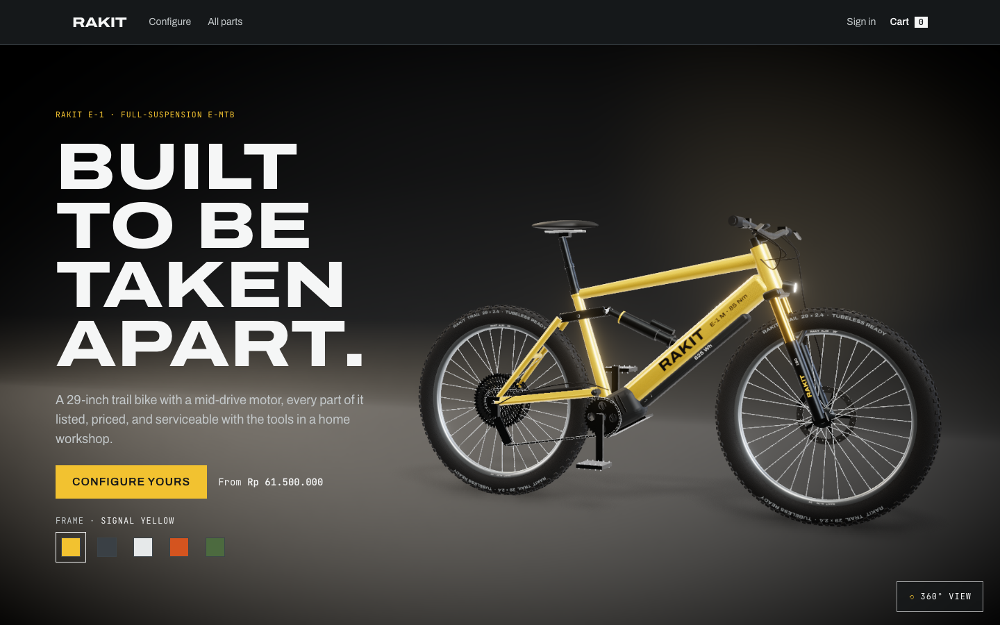
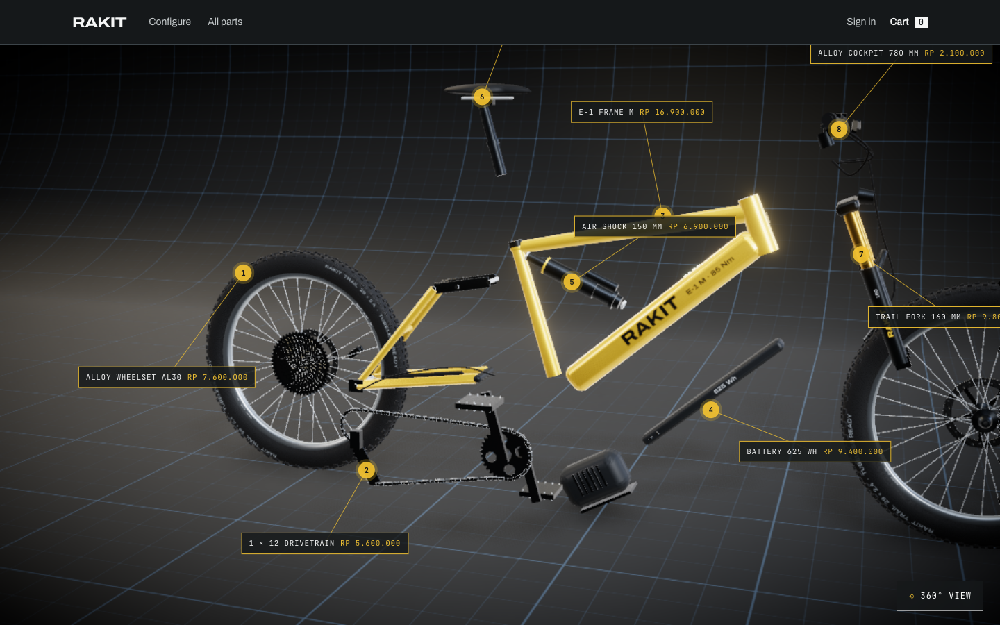
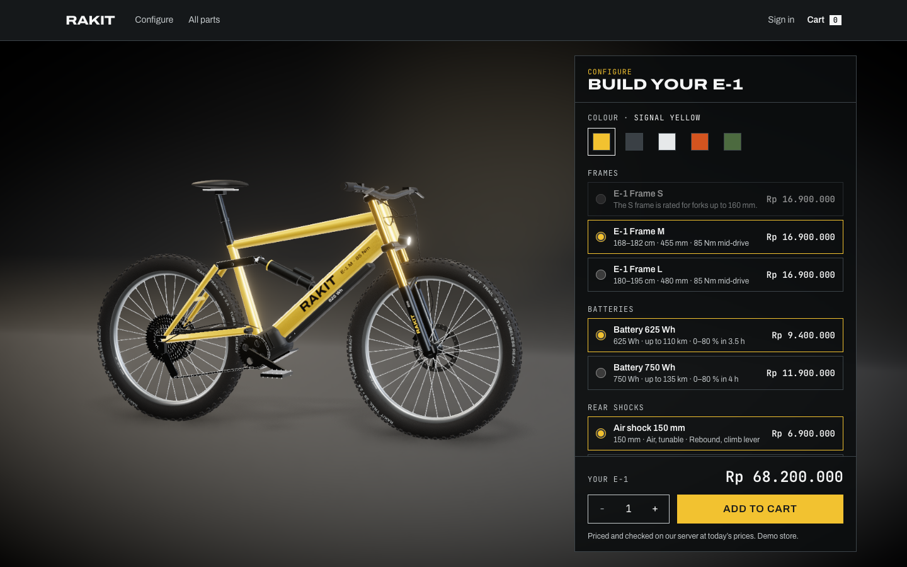
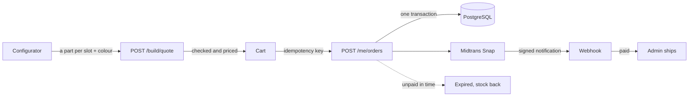
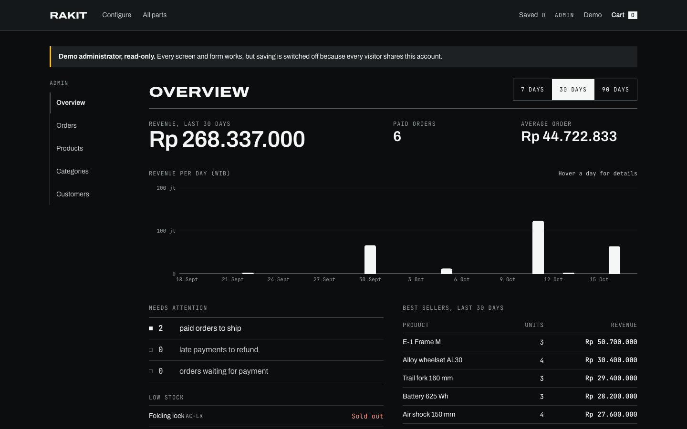

<h1 align="center">🚲 Rakit — E-bike Parts Store with a 3D Configurator</h1>

<div align="center">

[](https://yogi-store.vercel.app)
[](https://muhammadyogi.vercel.app/projects/rakit)
[](https://github.com/yogigaek/gear-store/actions/workflows/ci.yml)

</div>

<h3 align="center">Build an e-bike part by part in 3D, or buy any part on its own.<br/>Every price, rule and stock decision is made on the server.</h3>

<p align="center">
  
</p>

> 🧪 **A demo store.** Prices and stock are examples, payments run in Midtrans **sandbox**, and no money moves.
> Sign in with **"Try as shopper"** or **"Try as admin"** — no sign-up needed.

Started as a rebuild of my 2022 bootcamp capstone (MERN), redone with a modern stack and a new domain.

---

## 📑 Contents

- [✨ What it does](#-what-it-does)
- [🛒 How an order works](#-how-an-order-works)
- [🛠️ Tech stack](#️-tech-stack)
- [🔐 Security](#-security)
- [🚀 Run locally](#-run-locally)
- [📱 Mobile app](#-mobile-app)
- [📡 API](#-api)
- [🧪 Tests & CI](#-tests--ci)
- [☁️ Deploy](#️-deploy)
- [📁 Project structure](#-project-structure)

---

## ✨ What it does

- 🚲 **3D bike, drawn in code** — the E-1 is built from three.js geometry in React Three Fiber, not loaded from
  a model file. The home page rides it forward as you scroll, takes it apart into its eight modules with a
  price on each, and offers a 360° inspect mode.
- 🧩 **Configurator** — one part per slot (frame, battery, shock, fork, wheelset, drivetrain, cockpit, seatpost)
  and a frame colour. The 3D bike changes with every choice; parts that cannot go together stay listed,
  disabled, with the reason.
- 🔩 **Parts catalogue** — 30 parts and accessories, filtered by part type, price and stock. Each product page
  shows the part in 3D; a bike part's page opens the configurator with it fitted.
- 🛍️ **Shopping** — wishlist, reviews from customers who paid for the product, a guest cart kept in the browser
  and merged into the account cart on sign-in, saved addresses with shipping by province, checkout, and
  payment on the Midtrans Snap page.
- 📊 **Admin** — revenue overview with a daily chart, orders (ship with courier and tracking, mark delivered,
  record refunds), products, categories and customer roles. The shared demo admin can open everything but
  save nothing.
- 💻 **Light where it has to be** — without a GPU (WebGL drawn in software) the page shows a still instead of
  the 3D, so it stays responsive; the configurator works the same.

<table>
  <tr>
    <td width="50%"></td>
    <td width="50%"></td>
  </tr>
  <tr>
    <td align="center">🔧 Teardown: eight modules, each with its price</td>
    <td align="center">🧩 Configurator: conflicts disabled with the reason</td>
  </tr>
</table>

---

## 🛒 How an order works

> 💡 The browser only ever sends **which** parts and **how many**. Every price, rule and stock decision is
> made on the server, from the database.



| Step              | What happens                                                                                                                                                                                                                                                                                                                 |
| ----------------- | ---------------------------------------------------------------------------------------------------------------------------------------------------------------------------------------------------------------------------------------------------------------------------------------------------------------------------- |
| 1️⃣ **Quote**      | `POST /build/quote` checks the bike against the rules in the database: every slot filled once, each part from its own slot and on sale, no conflicting pair (an S frame takes no 750 Wh battery, no fork over 160 mm, no 200 mm dropper), a colour the frame comes in. The bike is priced as the sum of its parts.           |
| 2️⃣ **Cart**       | A bike in the cart is kept as its parts. A part on a bike and the same part on its own count against one stock.                                                                                                                                                                                                              |
| 3️⃣ **Checkout**   | The cart is checked and priced again, then each part's stock is taken with a guarded `UPDATE … WHERE stock >= qty` (in id order), the order written and the cart emptied, all in **one transaction**. Two buyers can never both get the last unit. An idempotency key makes a double click or a retry return the same order. |
| 4️⃣ **Payment**    | The visitor pays on the hosted Midtrans page. A notification is accepted only with a valid **SHA-512 signature** (compared in constant time) and the order's exact amount. Repeats change nothing, every notification is logged, and money that arrives after an order closed is flagged for refund instead of reopening it. |
| 5️⃣ **Expiry**     | An unpaid order closes and its stock goes back on sale: after 60 minutes, or 10 on the shared demo accounts. This runs when orders are read or placed, not on a timer, so it also works on a host that sleeps.                                                                                                               |
| 6️⃣ **Fulfilment** | Every status move (paid → shipped → delivered, refund recorded) is a conditional update with a timeline entry in the same transaction.                                                                                                                                                                                       |

✅ Each step is covered by API tests against a real PostgreSQL, for example _"sells the last unit to exactly one
of two buyers checking out at the same moment"_ and _"marks the order paid once, however many times Midtrans
repeats it"_.

---

## 🛠️ Tech stack

**Web**<br/>


**3D**<br/>


**API**<br/>


**Mobile**<br/>


**Tests & delivery**<br/>


| Part                          | Tools                                                                              |
| ----------------------------- | ---------------------------------------------------------------------------------- |
| 🖥️ Web (`apps/web`)           | React 19, Vite, TypeScript, React Router, TanStack Query, Tailwind CSS             |
| 🚲 3D                         | three.js, React Three Fiber, drei, postprocessing                                  |
| ⚙️ API (`apps/api`)           | NestJS, Prisma 7, PostgreSQL, argon2, Helmet, rate limiting, OpenAPI               |
| 📱 Mobile (`apps/mobile`)     | Expo SDK 58, React Native 0.88, Expo Router, TanStack Query, Expo SecureStore      |
| 🤝 Shared (`packages/shared`) | zod schemas: one contract for validation, the API docs, the web and the mobile app |
| 🧪 Tests                      | Vitest (unit, and API e2e against PostgreSQL), Playwright (browser)                |
| ☁️ Delivery                   | GitHub Actions, Vercel (web), Render (API), Neon (PostgreSQL), Midtrans sandbox    |

---

## 🔐 Security

- 🎟️ **Sessions** — 15-minute access tokens (`Authorization: Bearer`) and a refresh token in an `HttpOnly`,
  `SameSite=Strict` cookie scoped to `/api/auth`. The refresh token rotates on every use; replaying an old one
  revokes the session. Signing out or resetting a password takes effect at once. The mobile app keeps its
  session in the phone's secure storage rather than a cookie, so `/auth/native/*` returns the refresh token in
  the body; those routes never read the cookie, so a script in the web page cannot turn it into a readable token.
- 🔑 **Accounts** — argon2id password hashing, email confirmation, the same reply whether or not an email has an
  account, and only SHA-256 hashes of tokens stored.
- 🚦 **Abuse** — after 5 failed sign-ins an address pauses for a minute, and every further failure doubles the
  pause up to an hour (unknown addresses alike, so the pause reveals nothing); a wider limit per visitor network;
  per-address rate limits on email routes. Passwords are at least 8 characters.
- 🗄️ **Data** — CHECK constraints on prices and stock. Products are taken off sale, never deleted, so orders keep
  their history. An admin product edit is refused if an order changed the stock since the form was opened.
- 🌐 **Web** — a Content Security Policy without `unsafe-eval` or inline scripts, HSTS, and `frame-ancestors none`.

---

## 🚀 Run locally

**Requirements:** Node.js 22+, npm 11+ and Docker.

```sh
cp .env.example .env                 # settings for local development; never committed
docker compose up -d --wait          # PostgreSQL on :5436, Mailpit on :8025
npm ci
npm run db:deploy -w @gear-store/api
npm run db:seed -w @gear-store/api   # parts catalogue, demo accounts and demo order history
npm run admin:grant -w @gear-store/api -- you@example.com   # make your own account an administrator
npm run dev:api                      # http://localhost:3000/api/docs (OpenAPI)
npm run dev:web                      # http://localhost:5173
```

- 📬 Emails (confirmation, password reset) land in **Mailpit** at http://localhost:8025.
- 💳 Payments need a Midtrans **sandbox** server key in `.env`; without one, checkout says payments are not set up.

---

## 📱 Mobile app

`apps/mobile` is the store on a phone: Expo SDK 58, React Native 0.88 and Expo Router, on the same API and the same
zod contracts from `packages/shared` as the web.

- 🔎 **Catalogue** — search, part types, and each part with its finishes and specs.
- 🛒 **Cart** — kept on the phone until sign-in, then merged into the account under a merge key, so a cut-off
  merge is resent and never adds twice; parts that do not fit (50 lines, 10 of each) are named in the cart.
  Prices and stock always come from the API.
- 🔑 **Sign-in** — `/auth/native/*`; the refresh token lives in the phone's secure storage (Keychain / Keystore),
  reads and writes of it run one at a time so a rotating token is never sent twice, and a reply that arrives
  after a sign-out or another sign-in is revoked rather than kept.
- 💳 **Checkout and orders** — saved addresses with their shipping fee, an idempotency key kept until the order
  comes back (leaving and re-entering checkout resends it), Midtrans sandbox payment in an in-app browser, and the
  order history with pay and cancel.

```sh
npm run build -w @gear-store/shared      # if packages/shared/dist is missing (`npm run typecheck` builds it too)
npm run dev:api                          # the API, as above; the phone reaches it on this machine's LAN address
npm run start -w @gear-store/mobile      # scan the QR code with Expo Go on a phone on the same Wi-Fi
npm test -w @gear-store/mobile           # unit tests, against a stand-in for the API
```

In development the app finds the API on the machine that serves it. A release build reads `EXPO_PUBLIC_API_URL`,
set in `apps/mobile/eas.json` to `https://yogi-store.vercel.app/api`: the phone goes through the web's `/api`
rewrite, as browsers do, so the API sees Vercel's own client address for its rate limits.

**Release build** (EAS, Android). EAS builds from the git tree, where `packages/shared/dist` is not committed, so
the app's `eas-build-post-install` script builds it; `eas-build-pre-install` installs npm 11, which this workspace
needs. Sign in to EAS with your own Expo account first:

```sh
cd apps/mobile
npx eas-cli login
npx eas-cli build -p android --profile preview      # an APK to install directly
npx eas-cli build -p android --profile production   # an app bundle for Google Play
```

---

## 📡 API

Interactive docs at `/api/docs`, the OpenAPI document at `/api/openapi.json`.

| Area         | Routes                                                                                   |
| ------------ | ---------------------------------------------------------------------------------------- |
| 🔩 Catalogue | `GET /categories`, `GET /products`, `GET /products/:slug`, product reviews               |
| 🧩 Build     | `GET /build` (slots, parts, conflicts), `POST /build/quote`                              |
| 👤 Account   | `/auth/*` (register, confirm, sign in, demo, refresh, reset), `/me`, addresses, wishlist |
| 📱 Mobile    | `/auth/native/*` (sign in, demo, refresh, sign out) with the refresh token in the body   |
| 🛒 Cart      | `POST /cart/quote` (guest cart), `/me/cart` parts and bikes, merge on sign-in            |
| 📦 Orders    | `POST /me/orders`, list, detail, cancel, pay, payment status                             |
| 💳 Payments  | `POST /payments/midtrans/notification`                                                   |
| 📊 Admin     | stats, orders (ship, deliver, refund), products, categories, customers                   |

---

## 🧪 Tests & CI

```sh
npm run typecheck
npm run lint
npm test                                   # unit tests
npm run test:e2e -w @gear-store/api        # API e2e; needs the database from docker compose
npm run test:browser                       # Playwright: API on :3000, `vite preview --port 5173`, Mailpit
npm run build
```

GitHub Actions runs on every push to `main` and every pull request, in two jobs:

- ✅ **check** — format, typecheck, lint, unit tests, migrations and seed, API e2e and the build.
- 🌐 **browser** — the whole stack in Chromium: sign-up through Mailpit, checkout, a signed payment notification
  and admin fulfilment.

<p align="center">
  
</p>

---

## ☁️ Deploy

| Part        | Host                      | Config                                                                                           |
| ----------- | ------------------------- | ------------------------------------------------------------------------------------------------ |
| 🗄️ Database | Neon (PostgreSQL 17)      | pooled URL for the app, direct URL for migrations                                                |
| ⚙️ API      | Render (free web service) | `render.yaml`; starts with migrations, then seeds an **empty** database and grants `ADMIN_EMAIL` |
| 🖥️ Web      | Vercel                    | `apps/web/vercel.json`; forwards `/api/*` to Render so the refresh cookie stays first-party      |

A push to `main` deploys both. ⏳ The API sleeps when idle on Render's free tier, so the first request after a
quiet spell is slower.

---

## 📁 Project structure

```text
gear-store/
├── apps/
│   ├── api/                 # ⚙️ NestJS API
│   │   ├── prisma/          #    schema and migrations
│   │   └── src/             #    auth, catalog, build, cart, orders, payments, reviews, admin, seed
│   ├── web/                 # 🖥️ React storefront and admin
│   │   └── src/
│   │       ├── pages/       #    home, parts, product, cart, checkout, orders, account, admin
│   │       ├── three/       #    🚲 the E-1 and its parts in three.js
│   │       └── lib/         #    API client, queries, auth
│   └── mobile/              # 📱 Expo app: catalogue, cart, sign-in, checkout, orders
├── packages/shared/         # 🤝 zod schemas shared by the API, the web and the mobile app
├── e2e/                     # 🌐 Playwright browser tests
└── docs/screenshots/        # 📸 images in this README
```

---

<div align="center">

👤 Built by **Muhammad Yogi** · Backend / Full-Stack Engineer

[](https://muhammadyogi.vercel.app)
[](https://www.linkedin.com/in/yogigaek)
[](https://github.com/yogigaek)

</div>
